  

  <a href="https://endermonks.com">EnderMonks</a>
  &nbsp;·&nbsp;
  <a href="mailto:heshal@endermonks.com">heshal@endermonks.com</a>

Plain-text version

**Heshal Dissanayake, The Custodian.** Final-year IT student at SLIIT, Sri Lanka. Data Science is the main discipline. Builds decision-support systems, geospatial analytics and connected sensing, and takes the work from raw data to a working interface.

### Case files
- **HD-001 · VCare Nursing** (Feb 2026, ongoing, in production). One platform for a home-healthcare business: booking site, client portal, mobile-first staff portal and a 32-module admin back office.
- **HD-002 · SLT GeoVision** (Jul to Sep 2026, built, pending launch). Ranks 13,021 areas across Sri Lanka to show where to lay fibre next, and explains each choice.
- **HD-003 · Cuisinise** (personal, runs locally). An agentic food-exploration platform: one message goes to a coordinator that calls six specialist AI services in parallel.

### Faculties
Languages · Data, ML and AI · Data, BI and Geo · Web · Databases · Cloud and DevOps · Mobile and IoT · Design · Leadership

